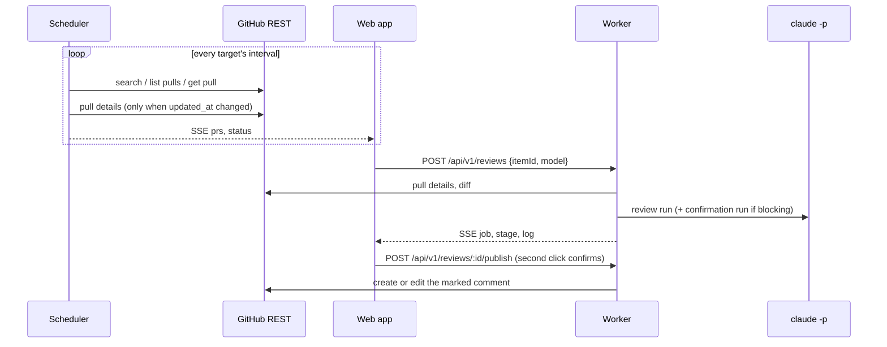

# Architecture

One Bun process in one pod: the API, the built SPA, SSE, the scheduler and the review
worker. SQLite on a persistent volume holds everything.

## Components

| Component | Where | Role |
|---|---|---|
| API | `src/api/app.ts`, `src/api/routes.ts` | Hono: sessions, CSRF, security headers, API v1, SSE, serves `web/dist` |
| Auth | `src/auth/auth.ts` | argon2id passwords, session cookies (sha256 in the DB), login rate limit |
| Accounts | `src/accounts/service.ts` | Validates GitHub tokens (`GET /user`) and Claude tokens (probe), stores them encrypted, re-checks |
| Scheduler | `src/scheduler/targets.ts` | Every 5 s polls due targets; upserts items; releases items no longer matched; auto-review; probes Claude limits every 30 min |
| Worker | `src/jobs/worker.ts` | One job at a time: PR details and diff → review pipeline → stored result |
| Publish | `src/jobs/publish.ts` | Creates or edits the marked PR comment. The only code path that writes to GitHub |
| GitHub client | `src/github/client.ts` | REST over `fetch` per account token; rate-limit headers, pagination, diff media type |
| Engine | `src/review/*`, `src/verdict/*` | See [review-pipeline.md](review-pipeline.md) |
| Web | `web/` | Vue 3 SPA: inbox with the review panel, targets, profiles, accounts, activity, settings, admin; ⌘K palette |

## Data model

| Table | Holds |
|---|---|
| `users`, `sessions` | Logins (admin/member) and sessions |
| `secrets` | AES-256-GCM ciphertexts; additional data binds each to its row id |
| `accounts` | A GitHub identity of a user: login, label, token (→ `secrets`), scopes, attached credential, default model, health |
| `credentials` | A Claude subscription token (→ `secrets`), label, health, last usage windows |
| `targets` | What to watch: `search` (qualifiers), `repo`, `pr`; filters (drafts, bots, labels, authors, owners, size), role, automation (`manual` / `auto-review`), model, poll interval, last error |
| `items` | A PR found by one or more targets: head/base sha, state (`open`, `closed`, `merged`, `unmatched`, `archived`), role, labels, size, the comment id |
| `profiles` | A user's review recipes: mode + options, version, default flag |
| `jobs` | A review: item, account, profile snapshot, mode, model, parts, status, verdict, counts, usage, full result JSON, comment URL once posted |
| `runs` | One model call of a review: purpose (review/confirm), part, model, duration, outcome, tokens, API-price estimate |
| `events` | The activity log (14 days) |
| `settings` | Instance settings (models) and the v1-import flag |
| `cache` | Verdicts by prompt version + model + diff + intent (24 h) |

Every owner-scoped row carries `user_id`, and every API query filters by the
session's user: users never see each other's accounts, items or reviews.

## Life of a review

- **Explicit by default.** Targets list PRs. A review starts on **review** (or on a
  new head sha for an `auto-review` target); a comment is written only on **post**.
- **Only known PRs can be reviewed.** A review is queued for an item, and items exist
  only because a target found them or the user added them by URL.
- **One comment per PR and account**, found by marker and author login, edited on
  repost; posting clears `comment_url` on earlier reviews of that PR.
- **Restart-safe.** A job left running goes back to the queue; nothing was posted.

## Security boundaries

- The model sees only text: `claude -p --tools ""`, environment built from scratch with
  just the credential's token. GitHub tokens never reach it.
- Tokens are decrypted only for the call that needs them; the API returns a
  fingerprint (`…abcd`), never a token or a secret id.
- Sessions: HttpOnly, Secure (behind HTTPS), SameSite=Strict; mutations need the
  same origin plus `x-requested-with: fetch`; CSP `default-src 'self'` (fonts are
  bundled).
- A token whose login changed marks the account `invalid` instead of acting under the
  wrong name.
