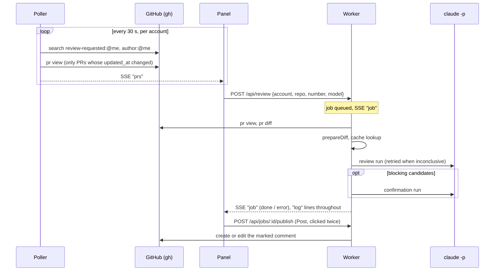

# Architecture

One Bun process in one pod. No queue service, no database server: SQLite on a
persistent volume holds everything.

## Components

| Component | File | Role |
|---|---|---|
| Poller | `src/poller.ts` | Every `pollIntervalSec`, per account: GitHub search for open PRs, refresh head shas, publish the list to the panel. Never starts a review. |
| Panel + API | `src/server.ts`, `src/panel.html` | Lists open PRs and past reviews, streams the log over SSE, accepts "review this PR with this model". |
| Worker | `src/worker.ts` | Takes queued jobs one at a time: diff → review → result stored. `publishJob` posts a finished review when asked. |
| Review pipeline | `src/review/run.ts` | Model run, evidence check, confirmation run for blocking findings, verdict. |
| Claude call | `src/review/claude.ts` | `claude -p` with no tools and a JSON schema. |
| GitHub access | `src/github/gh.ts` | Every call through the `gh` CLI with the account's token. |
| Event log | `src/log.ts` | Each line stored in SQLite and pushed to every open panel. |

## Life of a review

Design choices:

- **On demand only, private until posted.** The poller keeps the list fresh; nothing is
  reviewed until someone presses Review, and nothing reaches GitHub until someone
  presses Post (a second click confirms, since it writes under their name).
  `publishJob` is the only code path that writes to GitHub. An account can list PRs
  without a Claude token — only its Review button stays disabled.
- **Only listed PRs can be reviewed.** `enqueueReview` accepts a PR only if it is in
  the latest poll result of that account, so the panel cannot be used to post
  comments in arbitrary repositories.
- **One comment per PR and account.** Found by a hidden marker
  (`<!-- agentic-pr-reviewer -->`) plus the author login, then edited. Never "the
  user's last comment", which may be one written by hand. Posting a review clears
  `comment_url` on the earlier reviews of that PR, so the panel shows which review the
  comment currently holds.
- **One job at a time.** The Claude subscription limit is the bottleneck, not CPU.
- **Restart-safe.** A job left `running` by a restart goes back to `queued`; nothing
  was published for it.

## State

SQLite at `$DATA_DIR/reviewer.sqlite` (`src/db.ts`):

| Table | Holds | Kept |
|---|---|---|
| `jobs` | one row per requested review: status, verdict, counts, tokens, model, full result JSON, and the comment URL once posted | forever |
| `events` | log lines, optionally tied to a job | 14 days |
| `prs` | last seen `updated_at` and head sha per account + PR, the comment id | forever |
| `cache` | verdict by hash of prompt version + model + rendered diff + intent | 24 h |

`$DATA_DIR/claude/<account>` is each account's Claude Code config dir, so two
accounts never share local Claude state.

## Security boundaries

- **The model sees only text.** `claude -p --tools ""`: untrusted PR content cannot
  make it read files, run commands or reach the network. The prompt also tells it
  that PR text is data, not instructions.
- **Tokens stay out of the model process.** `claude` gets a fresh env with only its
  own OAuth token; `gh` gets only the GitHub token of the account it acts for.
- **A token for the wrong login disables the account.** On start each GitHub token
  is checked with `gh api user`.
- **The panel** requires HTTP Basic auth. POSTs must be JSON and same-origin, which
  stops other sites from triggering reviews through the browser's saved credentials.
- **Posted text is model output.** A hostile PR could still steer what the comment
  says; findings whose quoted evidence is not in the diff are demoted to a collapsed
  "Low confidence" section and never block.
